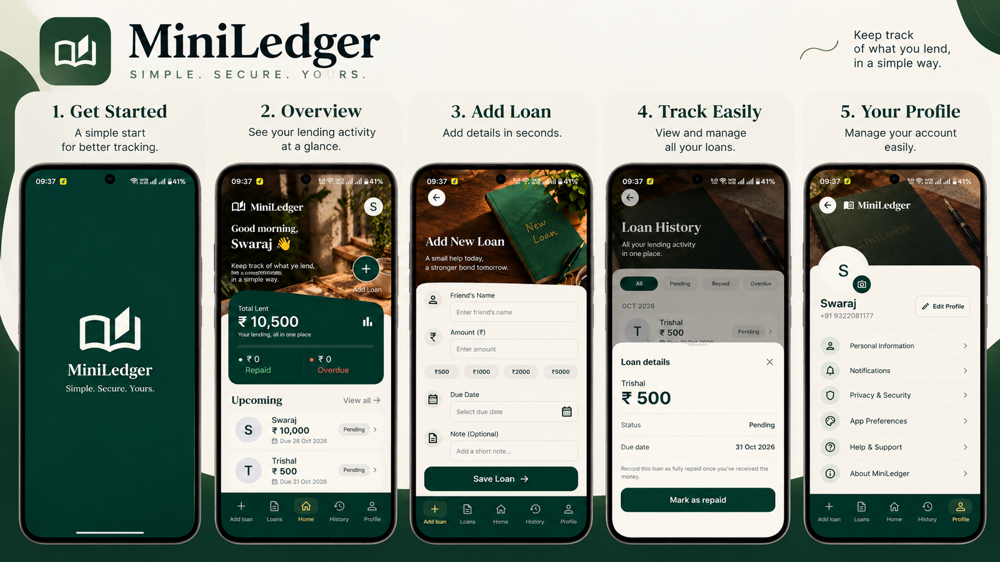

# HisabKitab

> **Your lending, clearly tracked.**
> A simple way to keep track of money lent to friends and family.



*The original MiniLedger design. I later renamed the app HisabKitab and updated the screens.*

## Why I built this

When you lend someone money, it is easy to forget the amount or whether they have paid you back. Keeping everything in chats or notes gets confusing after a while.

I built HisabKitab to keep those details in one place. You can add a loan, check what is still pending, and mark it as repaid when you receive the money. I wanted it to be something you can open and use without a long setup.

The current Android app works offline. You do not need to create an account or enter an OTP.

## What you can do

- Add a friend's name, amount, due date and an optional note.
- See how much you have lent, how much has been repaid, and what is overdue.
- Check outstanding balances by person or browse the full loan history.
- Mark a loan as repaid once you receive the full amount.
- Add your name and a profile photo.
- Export your records as CSV or save a JSON backup to restore later.
- Delete your local data from **Profile → Your Data**.

Amounts are in Indian rupees. The app keeps records; it does not send money or offer loans.

## Try the app

The signed Android APK is in [`releases/HisabKitab/`](releases/HisabKitab/). It runs on Android 7.0 or newer, without Expo Go or a backend server.

If you are downloading from GitHub, use the APK attached to the release when available. Build files are not included in the source repository.

## Built with

The offline Android app uses **Kotlin, Jetpack Compose and Room**. Loan records are stored locally on the phone.

This project started as a **React Native + Node.js + TypeScript + PostgreSQL** assignment. I have kept that implementation in `mobile/` and `backend/`. It uses mock OTP login, with the code printed in the backend terminal. It is separate from the offline APK.

For the original assignment setup, see [the setup guide](docs/ASSIGNMENT.md). There is also a [demo guide](docs/VIDEO-DEMO.md) for showing the backend and database flow.

## Build the Android app

Open the project in Android Studio and let Gradle sync. Use JDK 17 and install the Android SDK requested by the project.

For a debug build on Windows:

```powershell
.\gradlew.bat :app:assembleDebug
```

To build the signed APK and Play Store bundle:

```powershell
powershell -NoProfile -ExecutionPolicy Bypass -File scripts/build-hisabkitab-release.ps1
```

The release script saves the files in `releases/HisabKitab/`. It creates a signing key outside the project on the first run. Keep a secure backup of that key and its password: you will need them to publish updates.

More details are in the [release guide](docs/HISABKITAB-RELEASE.md).

## Your data

Your loans and profile stay on your phone. The offline app has no ads, analytics or internet permission.

Before changing phones or uninstalling, save a JSON backup from **Profile → Your Data**. There is no automatic cloud backup. CSV files are useful for spreadsheets, but cannot be restored into the app. Exported files are not encrypted, so keep them somewhere private.

## Project structure

```text
app/          Android app
mobile/       React Native assignment app
backend/      Node.js and PostgreSQL assignment backend
docs/         Setup, demo and release guides
scripts/      Local setup and release scripts
releases/     Release notes, artwork and locally built packages
image.png     Original design showcase
```

## Contact

Built by **Paramjit Baral**.

For questions or problems: [aapnastoreofficial@gmail.com](mailto:aapnastoreofficial@gmail.com)
